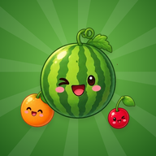
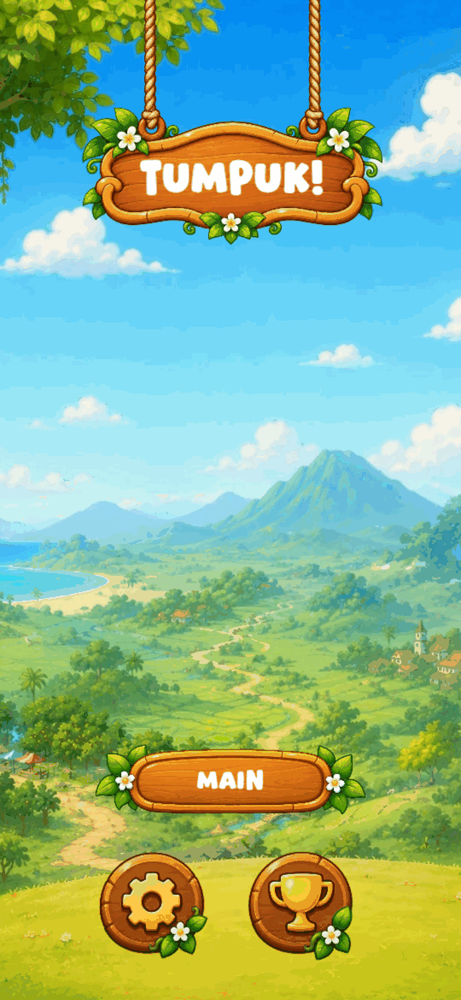
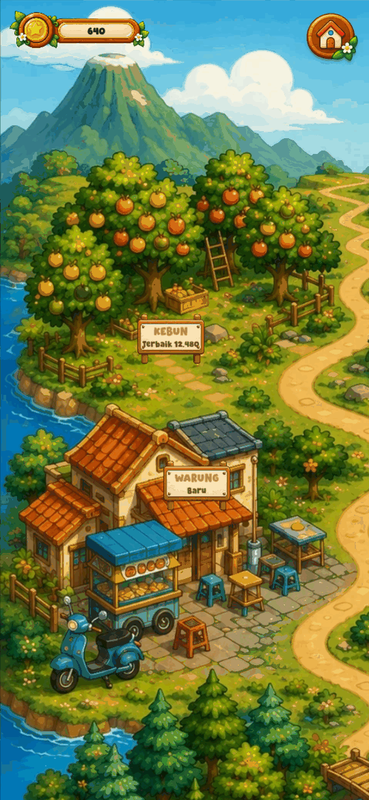
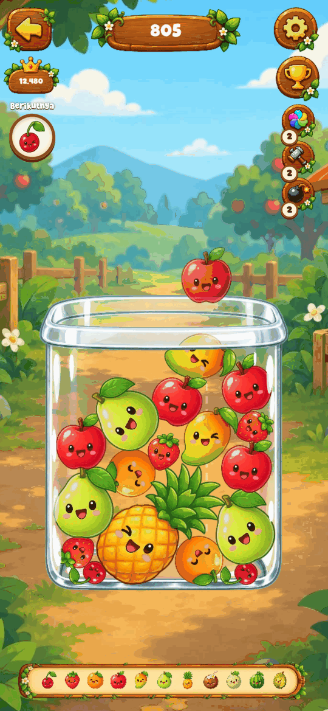
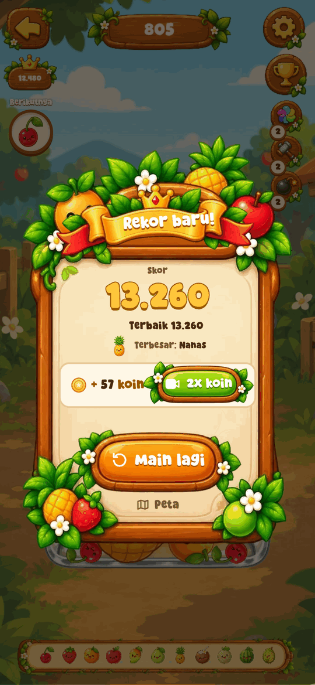

<div align="center">



# Tumpuk!

**Jatuhkan, gabungkan, tumpuk.**
Game merge ala Suika dengan 77 benda lucu dari 7 dunia Nusantara: dari ceri sampai durian, klepon sampai tumpeng, kunang-kunang sampai pohon beringin.

[](https://lav-studio-org.github.io/tumpuk-enh/)

[](https://github.com/Lav-Studio-Org/tumpuk-enh/actions/workflows/test.yml)
[](https://github.com/Lav-Studio-Org/tumpuk-enh/actions/workflows/pages.yml)







</div>

## Cara main

1. Geser untuk membidik, lepas untuk menjatuhkan.
2. Dua benda yang sama bergabung jadi benda berikutnya. Makin besar, makin banyak skor.
3. Jangan biarkan tumpukan melewati garis merah lebih dari 3,5 detik.
4. Kipas, Palu, dan Bom membantu saat toples penuh. Stoknya terbatas, jadi pakai dengan bijak.

## Fitur

- **7 dunia, 77 benda**: Kebun, Pasar, Warung, Pantai, Hutan, Desa, Misteri. Masing-masing dengan latar, musik, dan 11 tingkat evolusi sendiri.
- **Dunia terbuka berurutan**: capai skor target di dunia sebelumnya, atau buka langsung dengan koin.
- **Power-up berstok**: Kipas (goyang toples 10 detik), Palu (hancurkan satu benda), Bom (ledakkan area). Beli dengan koin atau dapat gratis lewat iklan berhadiah.
- **Hidupkan lagi** sekali per ronde: bagian atas toples dibersihkan, permainan lanjut.
- **Layar hasil** yang merayakan rekor baru, menampilkan benda terbesar ronde ini, 2x koin, dan jarak ke dunia berikutnya.
- **18 prestasi** dengan hadiah koin.
- **Preview benda berikutnya**, garis bantu jatuh, combo bernada Do-Re-Mi.
- **Pengaturan** volume musik dan efek suara (tersimpan).
- **PWA**: bisa dipasang ke layar utama dan dimainkan offline.
- **Ringan di HP lama**: otomatis pakai Canvas kalau WebGL2 tidak ada; musik dunia dimuat di belakang.

## Dunia dan target

| Dunia | Benda terakhir | Terbuka saat | Atau |
|---|---|---|---|
| Kebun | Durian | dari awal | |
| Pasar | Tumpeng | skor 4.000 di Kebun | 300 koin |
| Warung | Gerobak Mie | skor 5.000 di Pasar | 400 koin |
| Pantai | Paus | skor 6.000 di Warung | 500 koin |
| Hutan | Gajah | skor 7.000 di Pantai | 600 koin |
| Desa | Angkot | skor 8.000 di Hutan | 700 koin |
| Misteri | Pohon Beringin | skor 9.000 di Desa | 800 koin |

Target disetel dengan `scripts/balance.js` (bot acak dan bot rakus memainkan ronde penuh dengan fisika asli). Koin per ronde: `floor(sqrt(skor) / 2)`.

## Teknologi

[melonJS 20](https://melonjs.org) + Melon Runtime (editor) dengan fisika Matter.js, ES module tanpa build step. Lapisan UI (modal, HUD, toast) memakai DOM biasa di atas canvas, digambar dengan art kayu yang sama.

| Path | Isi |
|---|---|
| `index.html`, `index.js` | Boot, pemilihan renderer, preload |
| `js/stage/` | Layar: `Main`, `Maps`, `Gameplay`, `LoadingGame` |
| `js/renderables/` | Objek game (77 benda, spawner, power-up, efek) |
| `js/script/` | Konfigurasi dunia dan benda, util, prestasi |
| `js/ui/` | Lapisan DOM: `ui.js` (layar), `meta.js` (koin, stok, dunia), `sound.js` (volume, pemulihan audio), `ads.js` (iklan) |
| `css/ui.css` | Gaya lapisan DOM |
| `ui/` | Art yang dipotong dari atlas untuk DOM (`scripts/extract-ui-art.py`) |
| `data/` | Atlas, level, audio, font |
| `docs/UX_AUDIT.md` | Design critique sebelum enhancement |

### Iklan

Semua iklan lewat `js/ui/ads.js`. Di web tampil **IKLAN CONTOH**; versi Android cukup mengisi `window.TumpukNativeAds = { showRewarded, showInterstitial }`.

- Rewarded: `revive`, `double_coins`, `power_blower`, `power_hammer`, `power_bomb`
- Interstitial: `round_end`, hanya di jeda antar ronde, tidak di 3 game pertama, paling sering tiap 2 game, minimal 90 detik dari iklan lain. Mati di versi web.

## Jalankan lokal

```sh
git clone https://github.com/Lav-Studio-Org/tumpuk-enh.git
cd tumpuk-enh
python3 -m http.server 8123
```

Buka <http://localhost:8123/>.

### Tes dan skrip

```sh
node scripts/check-no-emoji.js          # tidak ada emoji / simbol sebagai ikon
node scripts/smoke.js                   # alur lengkap di Chromium (butuh server di 8123)
node scripts/balance.js 6 KEBUN,PASAR   # distribusi skor bot per dunia
python3 scripts/extract-ui-art.py       # potong ulang art DOM dari atlas
```

## Deploy

Setiap push ke `main` di-mirror ke `gh-pages` oleh `.github/workflows/pages.yml`. Aktifkan sekali di Settings > Pages > Deploy from a branch > `gh-pages` / root. Naikkan `CACHE` di `sw.js` setiap rilis.

## Catatan sumber

Kode awal adalah payload web dari APK Android (dibuat dengan editor Melon Runtime), bukan hasil dekompilasi Java/Kotlin. Enhancement di repo ini ditulis di atas payload itu.

## Lisensi aset

Semua grafis dan audio adalah milik Lav Studio. Font Super Bouncer disertakan di `data/fnt/`.
